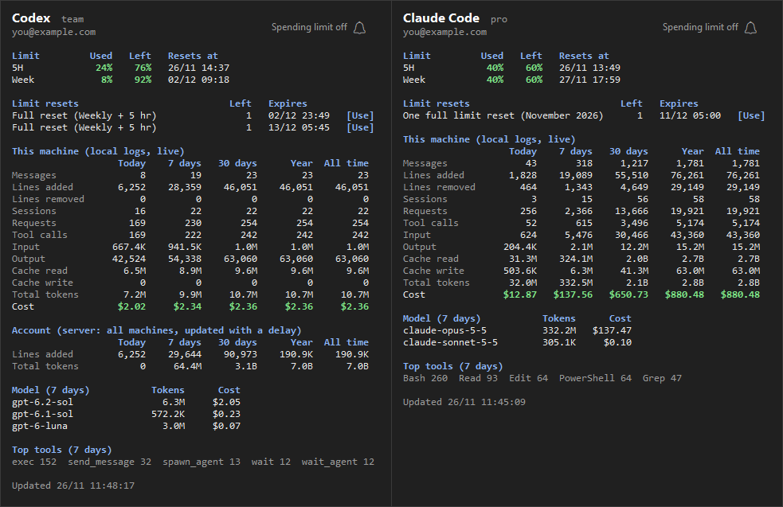
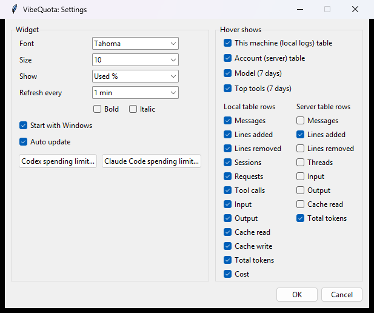
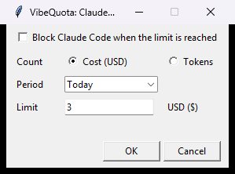

# VibeQuota

A small widget that lives **inside the Windows 11 taskbar** and shows how much of your
**Codex** and **Claude Code** subscription limits you have used.

```
[Codex icon]  5H 100%  W 43%
[Claude icon] 5H 94%   W 43%
```



- **5H**: % used of the 5-hour window. **W**: % used of the weekly limit.
  Green below 70%, orange from 70%, red from 90%.
- **Hover**: details for both tools side by side:
  - account, plan, every limit with its reset time;
  - limit resets with their expiry, each with a **[Use]** button (see below);
  - **This machine (local logs, live)**: messages, lines of code, sessions, requests, tool calls,
    tokens (input, output, cache) and estimated cost for Today / 7 days / 30 days / Year / All time,
    from this machine's logs, updated at every refresh;
  - **Account (server)** (Codex only): the whole account on every machine and in the cloud, as the
    Codex app's *Settings → Analytics* page shows it. The server updates it with a delay, so Today
    can read 0 for a while;
  - top models and top tools of the last 7 days.
- **Click**: refresh now. This also checks the sign-ins again, so a tool you just signed in to
  (or out of) appears (or disappears) without a restart.
- **Right-click** (widget or tray icon): Refresh, **Settings…**, **Codex spending limit…**,
  **Claude Code spending limit…**, Check for updates, Exit.
- A row is only shown when that tool is signed in on the machine or has an API key. With neither,
  the widget reads *No Codex / Claude sign-in*. With an API key instead of a subscription sign-in
  there are no 5H / W limits: the row reads **API key** (or the spending limit, see below) and the
  hover shows only the stats from local logs.
- If the usage API fails, Codex's 5H / W are read from the newest local log and marked
  *from local log at …*.

## Settings

Right-click → **Settings…** opens one window. Changes apply on **OK**.



- **Widget**: font, size, bold, italic; show *Used %* or *Remaining %*; refresh interval (1 to
  30 min, default 1 min; Claude quota at most every 3 to 3.5 min to avoid rate limits, unless you
  click); start with Windows; auto update; buttons for the Codex and Claude Code spending limits.
- **Hover shows**: turn each block on or off (local table, server table, Model, Top tools), and
  pick the rows of the local table and of the server table separately. By default the local table
  shows every row and the server table shows only *Lines added* and *Total tokens*.

## Limit resets

When an account has limit resets (Codex reset credits, Claude's monthly full reset), each one has a
**[Use]** button in the hover. Clicking it asks *Use this reset now?* right there in the hover;
**[Yes]** spends it, the same way the [Token Watch](https://marketplace.visualstudio.com/items?itemName=alvin0-dinhai.token-watch)
extension does, and then the limits refresh. The result, or the reason it failed, is shown under the list.
A used reset cannot be given back. A Claude reset that Claude marks as not usable right now has no button.

## Spending limits (Codex and Claude Code)

Each tool has its own limit. Open it with the small bell at the top right of that tool's hover column,
or right-click → **Codex spending limit…** / **Claude Code spending limit…**. A limit counts estimated
cost (USD) or tokens, for today, this month, the last 7 days or the last 30 days.



- With an API key a limit is on by default at **$3 a day**. With a subscription sign-in (ChatGPT,
  Claude Pro / Max) it is off by default, since those plans have their own 5H / weekly limits and the
  cost is only an estimate; it can still be turned on.
- Typing a value ticks *Block … when the limit is reached*.
- The row then shows `$1.20 / $3` and the hover shows how much of the limit is used. The bell's colour
  follows it: grey off, green, orange from 80%, red when blocked.

A tray notification warns at 80%, 85%, 90%, 95% and 100% of the limit, as Token Watch's cost alerts
do: each level once per period (remembered across restarts in `limit_alerts.json`), starting again on
a new day or month or when the limit changes, and noting when some usage has no known price.

Usage is estimated from this machine's logs only and checked at each refresh, so it can go a little
over before the block. A limit is a guard against overspending, not a security control.

### Codex

When the limit is reached, VibeQuota moves `~/.codex/auth.json` aside to
`auth.json.vibequota-locked` (and, if ticked, closes running `codex.exe`), so Codex has no key; the row
reads **BLOCKED**. When usage is under the limit again (a new day or month, a higher limit, or the limit
turned off) the file is put back. A key in the `OPENAI_API_KEY` environment variable is not blocked.

### Claude Code

Claude Code's sign-in is left alone (Claude Code rewrites it when it refreshes its token). Instead,
while the Claude Code limit is on, VibeQuota adds one `UserPromptSubmit` hook to
`~/.claude/settings.json` and removes it when the limit is turned off; other settings and hooks are
kept. When the limit is reached VibeQuota creates `%APPDATA%\VibeQuota\claude_blocked`, and while
that file exists the hook refuses every prompt with *Blocked by the VibeQuota spending limit*. When
usage is under the limit again the file is deleted.

- The hook runs with Git Bash, which Claude Code on Windows normally uses. Without Git Bash it does not block.
- A Claude Code session that was already open may need a restart to pick up the hook the first time.
- An answer that is already running is not stopped; the block applies from the next prompt.
- If VibeQuota is closed while blocked, Claude Code stays blocked until VibeQuota runs again and
  finds usage under the limit (or you delete that file).

## Several Codex accounts

Any other `*.json` file in `~/.codex` whose content is a Codex sign-in (ChatGPT account or API key),
whatever its name, is listed in an extra hover column with its own limits and a **[Switch]** button.
Switching makes it `auth.json` and saves the previous sign-in next to it (an API key is saved as
`auth_apikey_<last 4>.json`). Close Codex first: a running Codex can write its old token back.

`CODEX_HOME` and `CLAUDE_CONFIG_DIR` are respected when they are set.

## Install

Download `VibeQuota.exe` from [Releases](https://github.com/hiepkhach1005/VibeQuota/releases)
and run it. There is nothing to install.

- It starts with Windows by default. Turn this off with **Start with Windows** in **Settings…**. If you move the exe, run it once from the new place and the startup entry follows it.
- Only one copy runs at a time; launching it again does nothing.
- It updates itself. 30 seconds after start and then every 6 hours it checks the latest GitHub
  release. If that release is newer, it downloads `VibeQuota.exe`, swaps it in, and restarts.
  Turn this off with **Auto update** in **Settings…**, or update now with **Check for updates**
  in the right-click menu.
- Windows SmartScreen may warn the first time because the exe is not code-signed. Click
  **More info → Run anyway**.

To uninstall: untick **Start with Windows** in **Settings…**, choose **Exit**, then delete the exe and
`%APPDATA%\VibeQuota`.

## Where the data comes from

| Data | Codex | Claude Code |
|---|---|---|
| % used, resets, reset credits | `chatgpt.com/backend-api/wham/usage` and `wham/rate-limit-reset-credits` (newest local log if they fail) | `api.anthropic.com/api/oauth/usage?cedar_ember=1` |
| Using a reset | `wham/rate-limit-reset-credits/consume` | `api.anthropic.com/api/organizations/{org}/reset_rate_limits` |
| *Account (server)* table | `wham/analytics/*`, the same source as the Codex app's *Settings → Analytics* page | none |
| *This machine* table, top models and tools | Local session logs in `~/.codex/sessions`. Messages are typed prompts; lines are the `+` / `-` lines of edit patches | Local session logs in `~/.claude/projects`, counted the same way (shell edits are not counted) |

Local logs are read incrementally: after the first scan (which can take about 30 s with a large
history) each refresh reads only what was appended.

Cost is an estimate from public per-token prices, including the long-context tier for requests
over 272K tokens. Its pricing table follows the
[Token Watch](https://marketplace.visualstudio.com/items?itemName=alvin0-dinhai.token-watch) VS Code extension.

VibeQuota reads the sign-in that the Codex CLI (`~/.codex/auth.json`) and Claude Code
(`~/.claude/.credentials.json`) already store. It never refreshes or writes those tokens: if one
expires, use the CLI once and the next refresh picks up the new token. It only writes Codex's
sign-in files when you switch accounts or when the spending limit blocks and unblocks Codex,
and Claude Code's `settings.json` only to add or remove the spending-limit hook.
Nothing is sent anywhere except to those two providers' own APIs.

The endpoints are **undocumented** and can change without notice.

Settings and the last fetched numbers are kept in `%APPDATA%\VibeQuota`, so after a restart the
widget shows the previous numbers (marked *as of …*) until fresh ones arrive.

## Build from source

Requires Windows 11 and Python 3.11+.

```powershell
.\build.ps1   # -> dist\VibeQuota.exe
```

Or run it directly with `pythonw vibequota.py` after `pip install -r requirements.txt`.

## Releasing a new version

1. Raise `VERSION` in `vibequota.py`, for example to `"1.0.1"`.
2. Run `.\build.ps1`, then commit and push.
3. Create a GitHub release with the matching tag (`v1.0.1`) and attach `dist\VibeQuota.exe`.
   The asset must be named exactly `VibeQuota.exe`.

Installed copies pick it up within 6 hours, or straight away with **Check for updates**.
The updater only sees releases of a **public** repository, and it ignores drafts and pre-releases.

## How it sits in the taskbar

As [TrafficMonitor](https://github.com/zhongyang219/TrafficMonitor) does on Windows 11, the window
is made a child of `Shell_TrayWnd` with `WS_EX_LAYERED`. It is placed just left of
`TrayNotifyWnd` and re-positioned every 5 seconds.
